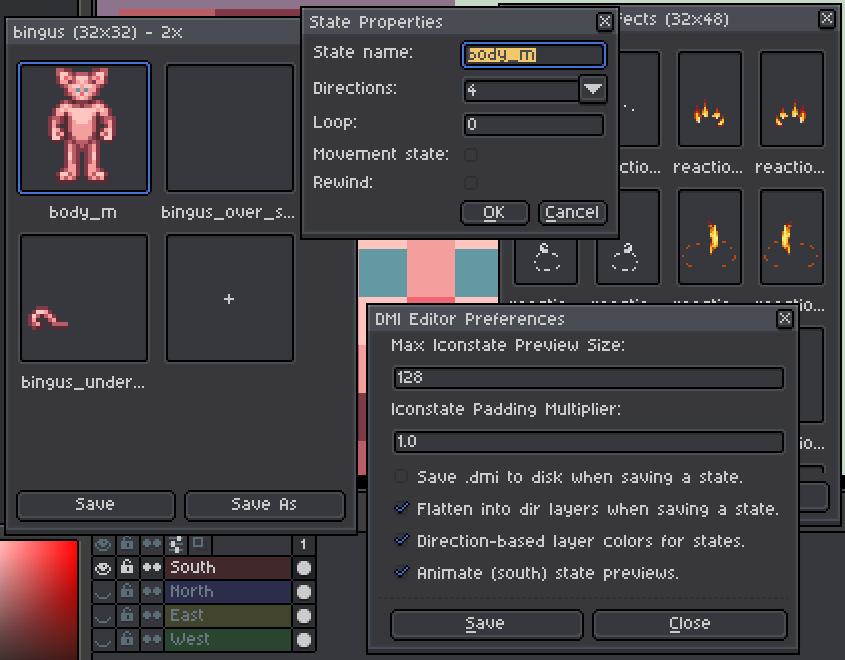

# DMI Editor for Aseprite

This project is a DMI (BYOND's Dream Maker icon files) editor extension for [Aseprite](https://www.aseprite.org), a popular pixel art tool.
It aims to enhance the Aseprite experience by providing tools for editing and managing DMI files.

## Download

The latest version of this extension is available for download from the [Releases](https://github.com/spacestation13/aseprite-dmi/releases) page.

The plugin will also prompt you to download an update when a new version is released.

### Requires Aseprite v1.3.18 or later.

## Usage

### Quickstart

1. **Install the extension:**
	- Download or build the extension, then add it to Aseprite by dragging and dropping the file into the application, or use `Edit > Preferences > Extensions > Add Extension`
2. **Open or create a DMI file:**
	- Open DMI files as you would any other file format in Aseprite
	- To create a new DMI file, go to `File > DMI Editor > New DMI File`

### Features

- Edit and manage BYOND DMI icon files directly in Aseprite
- Change icon state properties (name, directions, frames, etc.) via right-click or by clicking below the state
- Copy and paste icon states using the context menu (states are copied as JSON with embedded PNG images)
- Expand, resize, or crop DMI files from the `File > DMI Editor` menu
- Split/combine icon states in multiple ways
- `Ctrl`+click toggles a state in the selection and `Ctrl+Shift`+click selects a range, without opening the state
- Keyboard navigation in the state grid (click the grid first): arrow keys move the selection, `Shift`+arrows extend it, `Home`/`End`/`PageUp`/`PageDown` jump, `Enter` opens the state, `Delete` removes the selection (after confirming), `F2` edits properties, `Ctrl+A` selects all, `Ctrl+C`/`Ctrl+V` copy/paste states, `Esc` deselects (or closes the right-click menu). While the grid has focus, keys without `Ctrl`/`Alt` never reach the sprite you have open, and neither do `Ctrl+Z`/`Y`/`X`/`D`/`Delete`/`Backspace`; other shortcuts (`Ctrl+S`, `Alt` menus...) still work
- Type-ahead: type a state name to jump to it (names starting with the typed text first, then names containing it; the typed text resets after 1 second; pressing the same letter again cycles through states starting with it; `Backspace` removes the last typed character)
- `Ctrl+F`, `/` or right-click empty space > Find... opens Find States: as you type, the grid shows only the states whose name contains the text (case-insensitive), with the count in the editor's title (`12 of 143 states`). Arrows, type-ahead, `Ctrl+A` (select all matches) and the other grid keys work on the shown states, and the selection never keeps hidden ones. `Enter` closes Find and keeps the filter, with the cursor on the first match; `Esc`, Close, or clearing the text shows every state again, and so does `Esc` on the grid when nothing is selected (`Ctrl+F` reopens Find with the current text). States you add (new, paste, duplicate, split, combine, import) or rename while filtered stay shown until the text changes. Drag-reordering is off while filtered
- Access plugin preferences under `File > DMI Editor > Preferences`
- Codebase palettes under `File > DMI Editor > Palettes`:
	- `Codebase Palettes...`: pick a codebase's official palette (e.g. Goonstation) and apply it to the open sprite (optionally every open state of the DMI) or install it into Aseprite's palette Presets. The list comes from [`registry/palettes.json`](./registry/README.md), downloaded only when you open the dialog (cached for a day, works offline from the copy bundled with the extension); add your codebase's palette with a PR
	- `Palette from DMI...`: build a palette from the colors of one or more .dmi/.png files, most used first, optionally limited to the top N; apply it, install it as a preset or save it as .gpl
	- `Check Colors`: unique color counts of the active sprite per layer (direction) and frame, the colors not in its palette with pixel counts, and a button to select those pixels

### Platforms

Download the extension for your platform from the release:

- **Windows:** `aseprite-dmi-windows`
- **macOS:** `aseprite-dmi-macos`
- **Linux:** `aseprite-dmi-linux` (Steam or standalone)

Linux alternative: Windows Aseprite via Wine/Lutris

On older distros, you can run the Windows version of Aseprite and the extension through Lutris instead.

1. [Download](https://www.aseprite.org/buy/) or [compile](https://github.com/aseprite/aseprite) the **latest** Aseprite installer for Windows.
2. Open Lutris, click the plus icon in the top left, and select "Install a windows game from an executable".
3. Set the name to Aseprite and then click through the installer.
4. For "Select the setup file", choose the compiled or downloaded Aseprite Windows installer `Aseprite-*.exe`.
5. Finish the installation.
6. Open Aseprite and follow the Quickstart above, using `aseprite-dmi-windows`.

## Building the Project

### Requirements

-	[Rust](https://www.rust-lang.org/)
-	[Python](https://www.python.org/)
-	A C++ compiler (MSVC Build Tools on Windows, `g++`/`clang++` elsewhere)
-	The `lib/lua` submodule: `git submodule update --init`

Lua is compiled into the library from [Aseprite's Lua fork](https://github.com/aseprite/lua).

To build the project, run the `tools/build.py` Python script.

### Releasing

Push a git tag like `v1.0.8`, after changing the Cargo.toml and package.json files.

## LICENSE

**GPLv3**, for more details see the [LICENSE](./LICENSE).

Originally created by [Seefaaa](https://github.com/Seefaaa) at https://github.com/Seefaaa/aseprite-dmi
